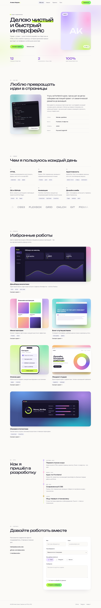

# 🚀 Портфолио будущего программиста

Учебный проект курса **«Современный CSS для frontend»**. Разметка уже готова. Вы стилизуете её вместе с преподавателем на парах, тема за темой. К концу курса у вас будет готовая страница для портфолио на двух технологиях: **HTML и CSS**.



> Так страница будет выглядеть в конце курса. Тёмная и светлая темы переключаются автоматически вместе с системой.

---

## 🎯 Как это работает

1. На паре преподаватель объясняет теорию новой темы.
2. В конце пары мы **закрепляем её на этом проекте**: пишем CSS для своих блоков в `style.css`.
3. Каждая тема живёт в **отдельном CSS-модуле** в папке `css/`. Файлы уже созданы, но пока пустые.
4. К каждому блоку в `index.html` привязана тема: ищите комментарии `🎯 ТЕМА N`.

---

## 🚀 Как начать

```bash
# 1. Нажмите Fork на GitHub, затем:
git clone https://github.com/ВАШ-ЛОГИН/css-portfolio-project.git
cd css-portfolio-project

# 2. Для каждой темы заводим ветку
git switch -c feature/box-model

# 3. После пары фиксируем результат и вливаем в main
git add .
git commit -m "feat: блочная модель — отступы и карточки"
git switch main
git merge feature/box-model
```

Откройте `index.html` через **Live Server** в VS Code, чтобы страница обновлялась сама.

Перед первой парой замените имя, город, текст «Обо мне» и ссылки на **свои**. Это ваше портфолио.

---

## 🗺️ Карта тем: где что искать

В `index.html` нажмите `Ctrl+F` (на macOS `Cmd+F`) и введите `ТЕМА 10`. Вы найдёте все блоки, где работаем с Flexbox.

| № | Тема | Где в разметке |
|---|------|----------------|
| 1 | Синтаксис | подключение `style.css` в `<head>`, ссылки, списки, весь файл |
| 2 | Блочная модель | секции, карточки навыков и проектов, блок фактов, форма |
| 3 | Единицы измерения | первый экран (hero), контейнер, отступы секций |
| 4 | CSS-переменные | `<body>`, цвета и размеры по всей странице |
| 5 | Стили текста | заголовок hero, «Обо мне», подписи, карточки |
| 6 | Шрифты | `<head>`, заголовки и основной текст |
| 7 | Псевдоклассы и псевдоэлементы | меню, бейдж, таймлайн, поля формы, ссылки |
| 8 | Изображения | аватар, фото «Обо мне», обложки проектов |
| 9 | Стилизация форм | блок «Давайте работать вместе» |
| 10 | Flexbox | шапка, кнопки, теги, подвал, контакты |
| 11 | Grid | hero, статистика, навыки, проекты, контакты |
| 12 | Позиционирование и z-index | липкая шапка, стикеры, таймлайн, подпись на фото |
| 13 | Тени и градиенты | фон hero, кнопки, карточки, градиентный текст |
| 14 | Фильтры | шапка, фото, обложки проектов, бегущая строка |
| 15 | Трансформации | hover карточек, кнопок, фото, стикеры |
| 16 | Transition | все hover-эффекты |
| 17 | Анимация | пульсация, парящие стикеры, бегущая строка |

---

## 📁 Структура проекта

```
css-portfolio-project/
├── index.html            ← готовая разметка (меняем только тексты и ссылки)
├── style.css             ← главный файл: только @import модулей
├── css/                  ← 17 модулей, по одному на тему
│   ├── 01-syntax.css
│   ├── 02-box-model.css
│   ├── 03-units.css
│   ├── 04-variables.css
│   ├── 05-text.css
│   ├── 06-fonts.css
│   ├── 07-pseudo.css
│   ├── 08-images.css
│   ├── 09-forms.css
│   ├── 10-flexbox.css
│   ├── 11-grid.css
│   ├── 12-positioning.css
│   ├── 13-shadows-gradients.css
│   ├── 14-filters.css
│   ├── 15-transforms.css
│   ├── 16-transitions.css
│   └── 17-animation.css
├── assets/
│   ├── img/              ← портрет-заглушка, фото, 6 обложек проектов (webp)
│   └── fonts/            ← Manrope и Unbounded (woff2, латиница и кириллица)
└── preview/              ← картинки итогового дизайна
```

### Как работает `style.css`

В `index.html` подключён **один** файл `style.css`. Внутри него правила `@import` собирают все модули:

```css
@import url("css/01-syntax.css");
@import url("css/02-box-model.css");
/* ... и так далее до 17 ... */
```

Так каждая тема остаётся в своём файле, а браузер видит их как единую таблицу стилей. Порядок импортов важен: файлы, подключённые ниже, имеют больший приоритет при равной специфичности.

> 💡 На паре вы открываете **только модуль текущей темы** и пишете код в нём.

---

## ✅ Критерии готовности

- [ ] Все 17 модулей в папке `css/` заполнены.
- [ ] Страница выглядит как на картинках из `preview/` (тёмная и светлая тема).
- [ ] Нет горизонтальной прокрутки на ширинах от 320px до 1920px.
- [ ] Мобильное меню (бургер) открывается и закрывается.
- [ ] Меню и форма работают с клавиатуры (видна рамка фокуса).
- [ ] В коде нет `!important` (кроме блока `prefers-reduced-motion`).
- [ ] Ваши имя, текст и ссылки вместо учебных.
- [ ] Каждая тема влита в `main` отдельным коммитом.

---

## 🔤 Лицензии

Шрифты **Manrope** и **Unbounded** распространяются по лицензии SIL Open Font License 1.1. Изображения в `assets/img/` созданы специально для курса и свободны для использования. Портрет в hero — заглушка: замените `portrait.webp` на своё фото (пропорции 4:5).
